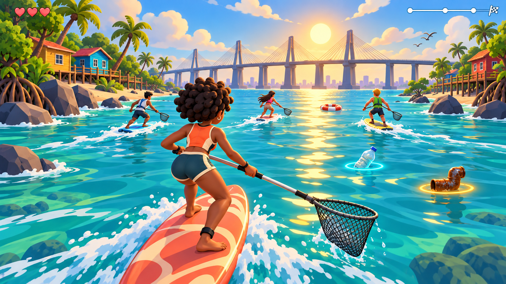

# Compunube · escena objetivo, propuesta 01

Referencia visual para revisar antes de modificar el juego. La imagen se genera con imagegen integrado; es arte conceptual, no una captura de una implementación ni una garantía de rendimiento o acabado idéntico.

Se conserva el [prompt de la edición seleccionada](concepts/maracaibo-objetivo-v1-prompt.md), además del prompt inicial incluido al final de este documento. Ambas pasadas utilizaron imagegen integrada.

## Revisión de la propuesta

La primera generación quedó demasiado realista. La imagen seleccionada aplica una segunda pasada hacia caricatura: rizos agrupados, vegetación por masas, rocas con planos grandes y agua con trazos amplios. Esta imagen define una dirección para explorar, no un recurso de ejecución. La bolsa, proporciones y agarres deben resolverse con los modelos y reglas reales; los halos no cambian el alcance de recogida. Su encuadre acercado y la vegetación deben ajustarse para conservar visibilidad y rendimiento en el navegador.

El [primer traslado a modelos reales](AMARA_PILOT.md) trabaja Amara, una pequeña orilla y el tratamiento del agua en un encuadre comparable. El modelo de Amara está integrado; paisaje y agua se revisan en la escena piloto. La creación de esta ilustración no modificó la simulación. El resto del acabado se extenderá tras revisar la comparación.

## Intención

Una escena de Maracaibo desde la cámara de carrera: Amara en primer plano, tabla y recogedor con bolsa en U, tres rivales, residuos identificables, orillas compuestas en grupos y puente al frente. Estilo animado con proporciones más cuidadas, materiales diferenciados y luz cálida desde el horizonte.

## Qué trasladar después a Blender y al juego

- Revisar la silueta posterior y las transiciones de hombros, manos y piernas.
- Diseñar ropa y equipamiento con formas grandes que se lean a tamaño de carrera.
- Agrupar paisaje, variar contornos y conservar el canal abierto.
- Ajustar valores, iluminación, reflejo, estela y contacto con agua como un conjunto.

La herramienta de imagen puede producir errores en manos, agarres, tejido o geometría del puente; el modelado debe resolverlos. La referencia mantiene la orientación del puente y el estilo de caricatura. La vista trasera aprobada sigue siendo parte del producto, aunque la ilustración se concentre en la escena.

## Referencias de criterio

La [guía artística de Valve](https://help.steampowered.com/en/faqs/view/0688-7692-4D5A-1935) explica silueta, valores y revisión desde la cámara del juego. El [resumen de diseño visual de niveles de GDC](https://www.gdcvault.com/play/1029212/Level-Design-Summit-A-Visual) destaca forma y composición dentro de la producción del nivel.

## Prompt inicial de generación

+Use case: stylized-concept.
Asset type: visual target concept for the existing Compunube 3D surfing and water-cleanup racing browser game; a single wide landscape in-game camera composition, not promotional cover art.
Primary request: Make a convincingly art-directed, attractive stylized 3D videogame scene with moderate, achievable asset complexity, improving a simple prototype into an appealing coherent cartoon world. It must feel playful, Venezuelan, sunny, and carefully designed.
Scene: Lake Maracaibo, Venezuela. The General Rafael Urdaneta bridge is a graceful concrete multi-span cable-stayed landmark stretching across the far FORWARD horizon. Show broad tall piers and restrained fan-shaped stays, not a suspension bridge. Tropical sandy banks frame the playable water channel, with asymmetrical rock silhouettes, mangrove roots, palms with varied leaf shapes, and a few wooden colorful palafito houses on stilts grouped naturally rather than evenly spaced. Keep the center channel clear.
Camera: third-person race camera behind and slightly above the foreground player, looking toward the bridge and sun. The foreground surfer occupies about 30 percent of image height, with full board and net visible. Perspective, depth and readable shapes should feel like a plausible playable game screenshot. Three smaller opponents ahead at varied distances, mixed women and men, light and dark skin, visibly different hair silhouettes.
Foreground player: Amara, an athletic young adult woman with deep brown skin, a well-designed rounded afro with grouped curls, wearing a fitted coral-orange watersports vest with ivory panels, visible zipper and broad shoulder seams, dark teal shorts with a cream edge. Friendly expressive stylized adult proportions, about five heads tall, with carefully modeled connected shoulders and limbs, substantial bare feet and hands. Show her back and a little of her profile; personality comes from silhouette, clothing construction, weight and pose. She is balanced in a dynamic surf stance, knees softly bent, torso subtly twisted, natural elbows, both hands gripping one long pool-cleaning pole.
Equipment: a coral surfboard with an elegant tapered rounded outline, designed deck panels, worn cream accents, a dark textured grip pad and a clear water-contact shadow. Pool-cleaning pole extends forward to the player's RIGHT, made of reclaimed brushed metal with two dark grips and a visible connector. One open oval net rim near the water at the right of the board, angled so its open mouth and deep U-shaped hanging mesh bag are clearly visible. The net is outside the body and does not intersect the surfer or board. Two hands spaced along the same pole, sensible anatomy and believable grip. Fine but readable diagonal woven mesh with an open top and a rounded bottom, not a flat tennis racket.
Pickups: only a few readable items at middle distance: an actual small plastic bottle floating with a subtle translucent cyan halo beneath it, a small hollow bent J-shaped rusty metal pipe with a subtle amber halo. They are rewards to collect, not huge foreground clutter. A simple red-and-cream lifebuoy further ahead.
Water: deep rich lagoon teal transitioning to turquoise at banks, broad softly shaded ripples with restrained light-dark variation, stylized warm broken sunlight reflections leading from forward sun toward the camera, transparent shallows, a flowing curved white foam wake behind the board with occasional delicate droplets and subtle foam around partially submerged rocks. Water stays readable and calm enough to see pickups; avoid repeated identical huge sine-wave lines and avoid metallic mirror-like ocean.
Light/materials: morning light from the low sun ABOVE the distant bridge, warm rim light on head and vest and cooler soft fill from camera, controlled contact shadows and ambient occlusion. Matte fabric, slightly reflective worn pole metal, smooth board paint, subtle hand-painted rock and wooden house surfaces. Use deliberate material separation and broad value groups. Soft atmospheric perspective gives three clear layers: character, racing channel, distant landscape. A few beautiful stylized cloud shapes and small distant birds.
Style: high-quality stylized realtime 3D game art, soft painterly material accents and clean designed silhouettes, cohesive warm coral/cream versus lagoon teal palette. Refined medium-detail geometry; natural asymmetry and pleasing shape rhythm. NOT photorealistic, not faceted generic low-poly, not clay toy, not assembled balls and cylinders, not oversized toddler bobblehead. Strong art direction rather than excessive tiny detail or cinematic photorealism.
UI: only three tiny coral hearts in the top-left and a small neat pale distance/progress line in the top-right. No opaque HUD containers, no floating character name labels, no minimap, no pause overlay, no large text, no typography, no logo, no watermark. Preserve abundant game visibility.
Constraints: one unified scene; four surfers total; foreground woman recognizable from back; bridge always ahead; warm forward solar reflection; one correct open mesh collector with U-shaped bottom; no guns, cars, mountains, elaborate fantasy armor, futuristic neon, or extra invented gameplay features.
