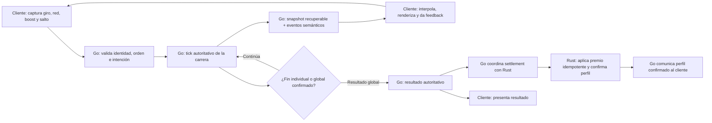

# B13 · Core gameplay loop y autoridad online

**Estado:** reparto de responsabilidades para el MVP · **Fecha:** 17-10-2026.

La [auditoría B08](frontend-baseline.md) aporta el comportamiento observable de la demo; [B09](multiplayer-decisions.md) fija las decisiones multijugador y [B10](online-player-flow.md) el recorrido del jugador. B13 describe cómo circula la información durante una carrera online. El servicio real aún no está conectado al frontend. Las reglas numéricas y el protocolo definitivo pertenecen a tareas posteriores.

## Loop local observado

En [`game.js`](../../apps/web/dist/game.js), la demo inicia una cuenta atrás propia y, al correr, lee giro, lado de red, impulso y salto del navegador. Su simulación mueve al humano y a tres IA, consume o recarga energía, calcula salto y contacto con obstáculos, asigna residuos y salvavidas, aplica vidas/protección y persigue al humano con el pulpo. La red recoge por contacto; la recogida carga el impulso. Al llegar a meta, la demo muestra un resultado y comunica los materiales a la economía local; al quedarse sin vidas descalifica y no acredita lo recogido en esa carrera. El modo local puede pausarse al perder foco.

Este comportamiento se comprueba en [`game.js`](../../apps/web/dist/game.js), [`mechanics.js`](../../apps/web/dist/mechanics.js), [`collection.js`](../../apps/web/dist/collection.js), [`survival.js`](../../apps/web/dist/survival.js) y las pruebas de [carrera local](../../apps/web/tests/local-race.test.js) y [supervivencia](../../apps/web/tests/survival.test.js). La [prueba del enlace online](../../apps/web/tests/network-game-bridge.test.js) verifica que la ruta conectada no avanza la física ni acredita el perfil local. Es **evidencia de una simulación dentro de un navegador**, no la especificación final de física, balance o ranking online. En particular, la carrera local termina cuando termina el humano y su `onFinish` acredita en el perfil offline; ninguna de esas dos decisiones se traslada tal cual a una carrera entre humanos.

## Loop online autoritativo

1. **Inicio compartido.** Go confirma participantes, curso, versiones y reloj de salida. El cliente prepara recursos y representa la cuenta atrás; no decide el instante de inicio.
2. **Intención.** El cliente captura `steer`, `netSide`, solicitud de `boost` y pulsación de salto. Envía intenciones ordenadas; Go valida identidad, orden, rango y si el participante puede actuar. Una pulsación de salto no debe aplicarse dos veces por duplicación de entrada.
3. **Tick.** Go avanza posición/progreso, velocidad, energía, salto lógico, colisiones, recogidas, vidas/protección, persecución individual del pulpo y condiciones terminales. Rust **no participa en cada tick**.
4. **Objetos compartidos.** Go decide un único propietario de cada residuo y salvavidas. B09 establece prioridad por menor distancia autoritativa al centro y desempate determinista por `playerId`; B16 precisará el cálculo sin que B13 fije geometría o tolerancias.
5. **Publicación y presentación.** Go publica estado recuperable y eventos para efectos. El cliente interpola poses y dibuja Three.js, modelos GLB, cámara, HUD, audio, espuma/estela e indicadores; un evento puede activar feedback, pero la propiedad y los contadores se confirman por estado autoritativo. La presentación no predice física online.
6. **Cierre.** Go confirma meta, descalificación, salida o DNF conforme a B09/B16. Un fin individual detiene las intenciones de ese jugador y lo lleva a espera/espectador; los demás continúan. Go emite el resultado global. El cliente lo presenta sin llamar al `finish` local ni acreditar materiales; Go coordina después el settlement idempotente con Rust y comunica el perfil confirmado como paso separado.

Perder foco libera controles y **no pausa la sala**. Una desconexión accidental deja la carrera viva con intención neutral durante la ventana inicial de reentrada de B09; al volver, el cliente debe reconstruir la vista desde estado confirmado, sin ejecutar una simulación privada. [B10](online-player-flow.md) describe la experiencia visible de esos casos.

## Matriz de autoridad

| Sistema | Cliente (presentación web actual) | Go Match Service | Rust Player/Profile Service |
|---|---|---|---|
| Controles | Captura giro, lado de red, boost y pulsación de salto; envía intención. | Valida identidad, secuencia, rango y efecto permitido. | Ninguna responsabilidad en el tick. |
| Movimiento y posición | Renderiza e interpola X/Z, velocidad y progreso recibidos. | Decide trayectoria, velocidad y progreso. | Ninguna en el tick. |
| Salto | Solicita pulsación y anima la pose confirmada. | Consume cada salto válido una vez; resuelve trayectoria y colisión lógica. | Ninguna en el tick. |
| Red y residuos | Elige lado, anima red y muestra recogida confirmada. | Decide contacto, material, propietario único y carga de energía. | Ninguna en el tick. |
| Boost | Solicita uso y muestra efecto visual. | Decide disponibilidad, consumo de energía y velocidad resultante. | Ninguna en el tick. |
| Obstáculos | Dibuja modelos y feedback. | Decide contacto e impacto. | Ninguna en el tick. |
| Vidas, protección y salvavidas | Presenta corazones, protección, recuperación y objetos visibles. | Decide daño, protección lógica, recuperación y dueño único del salvavidas. | Ninguna en el tick. |
| Pulpo | Presenta modelo, animación, aviso y cámara trasera. | Mantiene persecución y contacto independientes por participante. | Ninguna en el tick. |
| Fin individual y global | Muestra meta, descalificación, espera/espectador y cierre confirmado; deja de enviar input terminal. | Decide estados terminales, tiempos, fin global y resultado. | Ninguna durante la carrera. |
| Premio y perfil | Muestra resultado y, por separado, último perfil confirmado; no suma materiales. | Produce resultado y coordina settlement; no modifica directamente datos privados de perfil. | Valida y aplica settlement idempotente; mantiene perfil, inventario y saldo. |

La misma frontera de autoridad aplica al futuro cliente Python, aunque su presentación visual pueda ser distinta: ambos clientes consumen únicamente la interfaz pública de Go. El gRPC Go↔Rust y PostgreSQL permanecen internos según [`ARCHITECTURE.md`](../../ARCHITECTURE.md).

## Snapshots y eventos necesarios

Esta tabla identifica **información conceptual**, no campos ni mensajes finales. Los [DTO propuestos por el frontend](../../apps/web/docs/backend/contracts-proposed.ts) y la [guía de adaptación](../../apps/web/docs/backend/FRONT_ADAPTER.md) sirven de referencia para E43; aún admiten casos anteriores a B09, como bots y un resultado sin DNF explícito.

| Información | Necesidad para los clientes |
|---|---|
| Inicio | Identidad de carrera, reloj e instante de salida del servidor, participantes confirmados, versiones de reglas/curso y descripción del recorrido necesaria para representar la misma carrera. |
| Snapshot autoritativo | Tick/tiempo y estado actual de **todos** los participantes: posición/progreso, salto lógico, lado de red, energía/boost, vidas/protección, estado terminal y entradas ya procesadas; además, propiedad de residuos/salvavidas y persecuciones por jugador. Debe bastar para incorporarse o reentrar sin reproducir todos los eventos previos. |
| Eventos semánticos | Recogida de residuo, salvavidas, golpe, llegada y descalificación; considerar salida y DNF al cerrar B16/E43. Deben poder deduplicarse para no repetir efectos. No sustituyen el snapshot ni conceden propiedad o premio por sí solos. |
| Resultado y perfil | Resultado autoritativo por participante, con condición terminal y materiales confirmados. La acreditación y el perfil actualizado pueden confirmarse después; nunca los declara el cliente. |

El frontend actual limita el envío periódico de intenciones a **hasta 20 Hz** y usa una interpolación visual cercana a **100 ms**. Son detalles de la preparación del cliente: **no fijan** la frecuencia del tick de Go, de snapshots, ni una regla de física o recompensa.

## No negociables y trabajo pendiente

- El cliente no envía posición, choque, pickup, vida, ranking ni premio como verdad. Go gobierna el estado vivo y el resultado; Rust gobierna economía y settlement fuera del tick.
- Una pausa, pérdida de foco o desconexión de un cliente no suspende la carrera de los demás. Un fin individual tampoco cierra por sí solo la carrera global.
- Un snapshot debe permitir recuperar la verdad actual; los eventos aportan feedback puntual. El cliente no acredita `finish` online ni convierte efectos visuales en estado de juego.
- **B16** cerrará física, colisiones, balance, condiciones numéricas, ranking y reglas autoritativas exactas.
- **B17** formalizará el ciclo de sala, participante, fin global y reentrada.
- **D28** definirá runtime, concurrencia, tick y publicación en Go; **E43** definirá contratos, compatibilidad y transporte. Este documento no fija frecuencias, URLs, endpoints ni payloads definitivos.
