# B17 · Ciclo de sala y participación multijugador

**Estado:** modelo de producto cerrado para el MVP online, **sin servicio conectado aún**. Esta especificación aplica las decisiones de [B09](multiplayer-decisions.md), el recorrido visible de [B10](online-player-flow.md) y las [reglas B16](authoritative-race-rules.md). Go confirma sala, preparación, inicio, carrera y resultado; el cliente presenta su estado. Los nombres siguientes son **estados conceptuales**, no mensajes ni DTO definitivos de E43.

## Sala y acceso

Una sala admite **hasta 4 humanos** y comienza una carrera solo con **2–4 presentes**, todos `ready`; el MVP online no rellena plazas con IA. Al crearla, el creador elige **Maracaibo u Orinoco**. El mapa permanece **fijo durante toda la vida de esa sala**, incluidas carreras repetidas; para cambiarlo se crea otra sala. El creador no tiene autoridad especial para iniciar, cambiar reglas, adjudicar objetos o cerrar el resultado. Si sale, los demás continúan mientras la sala tenga miembros; no se necesita migración de host.

| Estado de sala | Significado y entradas admitidas |
| --- | --- |
| **LOBBY** | Sala abierta, con plazas disponibles para crear/entrar. Go confirma miembros, mapa y versiones compatibles. Cada miembro prepara perfil, equipo/apariencia y elección de **Reducir** para la próxima participación; `ready` es editable. Con un solo humano permanece aquí. |
| **COUNTDOWN** | Hay al menos 2 humanos y **todos los presentes** están `ready`. Go inicia la cuenta atrás común de **3 s**. El roster aún puede invalidarse; un cambio de miembros, preparación o `ready` antes del inicio cancela la cuenta y devuelve a LOBBY. No se aceptan nuevos joins en este estado. |
| **RACING** | Go inició la carrera. Roster, mapa, `rulesVersion`, `courseVersion` y elecciones de participación quedan bloqueados para **esa carrera**; no hay joins ni cambios de equipo o ready. Go simula según B16. |
| **RESULTS** | Go cerró el resultado global. No acepta intenciones de carrera. La pantalla distingue resultado confirmado de settlement/perfil **pendiente o confirmado**; la demora de Rust no reabre la carrera ni cambia el ranking. |
| **CLOSED** | Sala vacía o cerrada; su código deja de ser utilizable. No se puede entrar ni iniciar otra carrera con él. |

La membresía solo se solicita en **LOBBY** y Go la confirma si hay plaza, sesión válida y versiones compatibles. Una identidad o personaje visible no concede pertenencia. En COUNTDOWN, RACING y RESULTS no hay incorporación a mitad de una carrera; la **reentrada** de un miembro ya confirmado durante RACING es distinta de un join nuevo. La cuenta atrás se inicia por condición de grupo confirmada, no por un botón privilegiado del creador.

```mermaid
stateDiagram-v2
    [*] --> LOBBY: sala creada
    LOBBY --> COUNTDOWN: 2–4 humanos; todos ready confirmados
    COUNTDOWN --> LOBBY: cambia miembro, preparación o ready antes del inicio
    COUNTDOWN --> RACING: terminan 3 s; Go fija roster y versiones
    RACING --> RESULTS: todos terminales o 45 s tras primer finished
    RESULTS --> LOBBY: repetir; miembros restantes not_ready
    LOBBY --> CLOSED: sala queda vacía o se cierra
    COUNTDOWN --> CLOSED: sala queda vacía
    RESULTS --> CLOSED: sala queda vacía o se cierra
    CLOSED --> [*]
```

## Participante y preparación

| Estado de participación | Significado |
| --- | --- |
| **not_ready** | Miembro del lobby sin preparación confirmada, o miembro que vuelve tras una carrera. No inicia por sí solo. |
| **ready** | Perfil online y recursos necesarios cargados, equipo/apariencia válidos y elección de **Reducir B14** confirmada para la **siguiente participación**. Go confirma `ready`; el cliente no lo anticipa. |
| **racing** | Participación activa; Go acepta únicamente intenciones válidas de giro, red, impulso y salto. |
| **reconnecting** | Conexión perdida **durante carrera**; hasta **15 s**, entrada neutral y simulación continua. La misma identidad/sesión puede recuperar estado completo. |
| **finished** | Cruzó meta según Go. Es terminal, deja de enviar intenciones y espera/especta hasta el resultado global. |
| **disqualified** | Llegó a 0 vidas. Es terminal, deja de enviar intenciones y espera/especta. |
| **left** | Salida voluntaria durante carrera o vencimiento de reentrada. Es terminal y no recibe materiales de esa carrera. |
| **dnf** | Seguía activo o reconectando al vencer el plazo global de **45 s** tras el primer `finished`. Es terminal y no recibe materiales. |

```mermaid
stateDiagram-v2
    [*] --> not_ready: entra en LOBBY
    not_ready --> ready: Go confirma perfil, recursos, equipo y Reducir
    ready --> not_ready: cambia preparación o retira ready antes del inicio
    ready --> racing: Go inicia tras COUNTDOWN
    racing --> reconnecting: corte accidental; entrada neutral
    reconnecting --> racing: misma identidad vuelve en 15 s; snapshot completo
    reconnecting --> left: vencen 15 s
    racing --> left: salida voluntaria confirmada
    racing --> finished: Go confirma meta
    racing --> disqualified: Go confirma 0 vidas
    reconnecting --> finished: Go confirma meta durante ausencia
    reconnecting --> disqualified: Go confirma 0 vidas durante ausencia
    racing --> dnf: vence plazo global
    reconnecting --> dnf: vence plazo global
    finished --> not_ready: resultado global; siguiente carrera
    disqualified --> not_ready: resultado global; siguiente carrera
    left --> not_ready: resultado global; si permanece miembro
    dnf --> not_ready: resultado global; siguiente carrera
```

La salida de un miembro **antes** de RACING lo elimina de la sala; no crea un resultado `left` de carrera. Si cambia preparación/equipamiento relevante o retira `ready` antes del inicio, Go lo devuelve a `not_ready`; COUNTDOWN se cancela. En LOBBY/COUNTDOWN, una pérdida de conexión **sin sesión utilizable** lleva a Go a quitar al miembro y a reevaluar el inicio; la ventana de 15 s de B09 solo aplica a **RACING**. Si la sala queda con uno solo, permanece en LOBBY esperando otro. La identidad, sesión y validación concreta de perfil quedan a E43 y a la implementación, sin elegir proveedor de autenticación aquí.

Al comenzar RACING se fijan mapa y versiones compatibles junto con roster y decisiones de Reducir. Una desconexión accidental no pausa la sala, no rebobina objetos y no crea un segundo participante; Go continúa con entrada neutral. Una reentrada válida recupera posición, vidas, objetos, elección educativa y reloj desde el estado autoritativo. Si el participante llega a meta o pierde todas las vidas mientras está ausente, conserva ese estado terminal; el temporizador de reentrada no lo sustituye por `left`. Pérdida de foco sin pérdida de sesión libera controles, pero no cambia por sí sola la membresía.

El **primer `finished`** activa el plazo de **45 s**. Go cierra antes cuando todos son terminales; al vencer, convierte a `dnf` a quienes siguen `racing` o `reconnecting`. `finished` y `disqualified` solo terminan la participación propia. Si todos salen o se descalifican antes de una primera meta, se cierra porque todos son terminales, sin inventar una llegada. Las recogidas confirmadas permanecen para el objetivo de agua de [B15](water-objective.md), incluso si el jugador termina sin materiales. El puesto y el premio siguen [B16](authoritative-race-rules.md): solo `finished` recibe puesto y puede acreditar los materiales confirmados; los demás estados terminales reciben 0.

En RESULTS, Go entrega resultado global confirmado y coordina settlement; Rust confirma el perfil por separado. Para repetir, los miembros que **siguen en la sala** vuelven a LOBBY como `not_ready`, con el **mismo mapa**. Deben confirmar de nuevo el perfil actualizado y una **nueva elección de Reducir** antes de pedir `ready`. Si el perfil aún está pendiente, no se marca `ready` ni se finge un saldo. Si nadie permanece, Go cierra la sala y el código queda inválido. B17 no decide almacenamiento histórico de salas o estadísticas educativas.

## Límites y continuidad

- **B18** incorporará esta máquina de estados al GDD con las reglas B09–B16 y el estado real de implementación.
- **D28** definirá runtime, concurrencia, timers y publicación de Go; **E43** definirá identidad pública, mensajes, DTO, compatibilidad y recuperación. Estos estados no fijan endpoints ni nombres finales de eventos.
- No se añaden host authority, votación de mapa, matchmaking, bots, pausa global ni cambio de los plazos **15 s / 45 s**.

La [preparación actual del frontend](../../apps/web/docs/backend/FRONT_ADAPTER.md) sirve como evidencia histórica: aún admite bots y no implementa toda la reentrada. B17 define la conducta esperada del MVP; la [arquitectura](../../ARCHITECTURE.md) conserva Go como autoridad de sala/carrera y Rust como autoridad de perfil.
