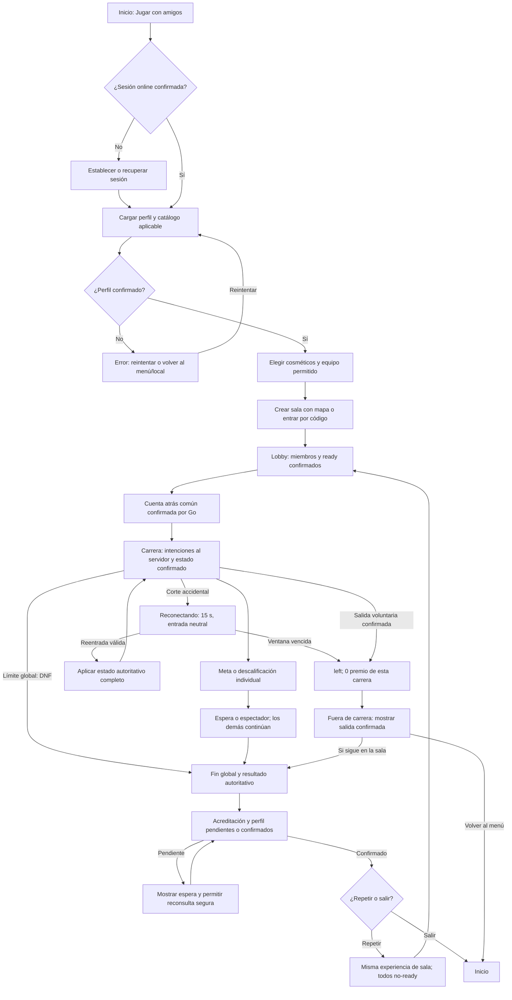

# B10 · Flujo completo del jugador online

**Estado:** definición de experiencia para el MVP · **Fecha:** 17-10-2026.

Este flujo parte de la [línea base B08](frontend-baseline.md) y aplica las [decisiones de producto B09](multiplayer-decisions.md). Describe qué ve y puede hacer una persona desde «Jugar con amigos» hasta el resultado, el perfil confirmado y el retorno. **Todavía no es una función disponible:** los adaptadores de sala y perfil del frontend siguen desconectados. B10 guía la futura UX; B16 fijará reglas exactas, B17 formalizará estados y transiciones, y E43 cerrará los contratos. La estrategia de clientes está en [ADR 0002](../adr/0002-client-language-strategy.md).

## Recorrido principal

El diagrama expresa pasos visibles, no una máquina de estados de sala. La ruta de error o salida puede volver al Inicio sin convertir una sesión online fallida en una carrera local implícita.

## Pasos, acciones y autoridad

| Paso | Acción y respuesta esperada | Fuente de autoridad |
|---|---|---|
| 1. Entrada | Desde Inicio se elige «Jugar con amigos». Si no hay sesión online válida, se ofrece establecerla o recuperarla antes de entrar a sala; también se puede volver. El modo local puede seguir disponible sin cuenta. | Backend confirma `playerId` y sesión; el personaje elegido no identifica la cuenta. B10 no fija proveedor ni credenciales. |
| 2. Perfil | Se solicitan perfil online y catálogo aplicable. Mientras cargan, tienda, canje, taller y equipamiento online no se pueden confirmar. Un fallo ofrece reintentar o volver al menú/modo local, **sin usar `localStorage` como perfil online**. | Servicio de perfil detrás de Go confirma identidad, inventario, saldo, catálogo y revisión. |
| 3. Preparación | Con perfil confirmado se eligen personaje, apariencia y equipo que el perfil permite o posee. Se aceptan personajes repetidos; nombre/indicador de interfaz distingue a los humanos. Los cambios se muestran definitivos solo al confirmarlos el servidor. No se importan compras, monedas, materiales ni carreras locales; una preferencia cosmética local puede usarse únicamente si es válida y permitida online. | Perfil/catálogo confirmados; el cliente expresa preferencias. |
| 4. Crear o entrar | Crear pide elegir **Maracaibo u Orinoco** y fija ese mapa para la sala; entrar usa código/ID. La capacidad es de 4 y la carrera necesita **2–4 humanos, sin IA de relleno**. La UI espera la sala confirmada antes de mostrar membresía o código compartible. | Go confirma sala, mapa, identidad y miembros; un código introducido no prueba que la sala exista. |
| 5. Lobby | Se muestran miembros confirmados, nombre, personaje/equipo visual y estado `ready`. Solo se permite pedir `ready` después de cargar perfil y recursos de carrera; mientras espera respuesta se indica «Confirmando…». Go lo hace efectivo al confirmarlo. Con al menos 2 humanos y todos los presentes listos, Go puede iniciar. | Go decide miembros, preparación e inicio; el cliente no rellena plazas ni se declara listo por su cuenta. |
| 6. Salida sincronizada | Go comunica el inicio y la cuenta atrás común. La escena se prepara con las versiones de reglas y curso confirmadas. Si son incompatibles, ese cliente no comienza y muestra el error. | Tiempo de salida, mapa, participantes y versiones proceden de Go. |
| 7. Carrera | Se envían intenciones de giro, lado de red, impulso y salto. La UI presenta posiciones, objetos, vidas, pulpo individual, llegada y descalificación a partir de snapshots/eventos confirmados. Perder foco libera controles y **no pausa** la sala. | Go simula y decide objetos, daño y resultado; el cliente dibuja estado y efectos. |
| 8. Corte accidental | Durante la carrera se muestra «Reconectando» dentro de la ventana inicial de **15 s**. Go mantiene la carrera e input neutral. Si vuelve la misma identidad/sesión a tiempo, el cliente recibe un estado completo antes de reanudar la presentación; no simula una carrera privada durante el corte. | Go conserva participación, reloj y estado autoritativo; el cliente solo recupera la vista. |
| 9. Salida o reentrada vencida | Al vencer los 15 s, el jugador queda `left` y recibe 0 premio. Para salir voluntariamente durante carrera se pide confirmación; al confirmar, la salida es inmediata, se dejan de enviar inputs y tampoco hay premio. | Go confirma la salida/expiración y el resultado; el cliente no lo inventa. |
| 10. Fin individual | Al llegar o descalificarse, cesan los controles de carrera de ese jugador. El HUD pasa a resumen propio y seguimiento/espera de los demás; la sala sigue corriendo. | Go confirma estado individual y mantiene la carrera restante. |
| 11. Fin global | La carrera termina cuando todos son terminales o transcurren **45 s desde el primer `finished`**, lo primero que ocurra. La pantalla distingue `finished`, `disqualified`, `left` y DNF y muestra la clasificación recibida, sin calcular el ranking final en el cliente. | Go emite cierre y resultado autoritativo; B16 precisará ranking y DNF. |
| 12. Acreditación | El resultado recibido se muestra como definitivo **separado** del estado «perfil/settlement pendiente». Solo `finished` puede recibir los materiales recogidos que Go confirmó; `disqualified`, `left` y DNF reciben 0, sin bonus por puesto. Si la actualización tarda, se informa y se reconsulta/reintenta de forma segura sin sumar recursos localmente ni reclamar dos veces. | Go coordina el resultado; Rust confirma el settlement idempotente y el perfil actualizado, siempre a través de Go. |
| 13. Retorno | Tras mostrar resultado y perfil confirmado, se puede volver a la experiencia de sala para repetir o salir al Inicio. Para otra carrera, todos vuelven a condición **no-ready** y confirman de nuevo. | Go confirma la sala y el siguiente inicio; B17 decidirá la transición exacta y si/cómo puede cambiarse el mapa. |

## Errores y rutas alternativas visibles

| Situación | Respuesta de la interfaz |
|---|---|
| Sin sesión o perfil online | Bloquear entrada a sala. Ofrecer establecer/recuperar sesión o volver; no sustituirla por el perfil offline. |
| Perfil temporalmente indisponible | Mostrar carga/error y «Reintentar»; mantener el último perfil confirmado cuando corresponda y no aplicar cambios económicos optimistas. El modo local permanece separado. |
| `ROOM_NOT_FOUND` o `ROOM_FULL` | Permanecer en entrada multijugador, explicar el error y permitir corregir código, elegir otra sala o reintentar. No mostrar una sala fabricada. |
| `SESSION_REQUIRED` | Volver al paso de sesión/perfil antes de cualquier entrada o acción online. |
| `INCOMPATIBLE_VERSION` | Bloquear entrada o inicio online y pedir actualizar/recargar; no continuar con reglas o curso distintos. |
| Conexión perdida en lobby | Mostrar desconexión. Si la sesión de sala ya no sirve, regresar a entrada online sin conservar miembros ni ready ficticios. |
| Conexión perdida en carrera | Overlay «Reconectando»; ventana inicial de 15 s y entrada neutral en Go. Reanudar solo tras identidad válida y snapshot completo; si expira, mostrar `left`/sin premio al recibir confirmación. |
| Abandono voluntario durante carrera | Pedir confirmación por la pérdida inmediata de participación y materiales de esa carrera; después cesar inputs y esperar confirmación de salida. |
| Resultado recibido, perfil pendiente | Conservar el resultado autoritativo visible y diferenciar que el saldo aún no está confirmado. Ofrecer reconsulta/reintento seguro; nunca sumar el premio localmente ni repetir el settlement. |
| Error en compra, fabricación o canje online | Mostrar código/mensaje estable, conservar el último perfil confirmado y no presentar gasto ni adquisición sin confirmación. |

## No negociables

- Online no usa `localStorage` como autoridad de identidad, saldo, inventario o recompensas, ni migra la economía de la demo.
- Ready, miembros, cuenta atrás, objetos, vidas, llegada, clasificación, resultado y perfil se muestran según confirmación del servidor. El cliente no inicia ni acredita una carrera por sí mismo.
- Pérdida de foco, desconexión y final individual no detienen la carrera de otros participantes.
- El resultado de carrera y la actualización del perfil son confirmaciones distintas. La demora de settlement no cambia el resultado ni autoriza un premio local.
- El MVP online usa 2–4 humanos sin bots; permite personajes repetidos y no otorga bonus por puesto. Solo `finished` recibe materiales confirmados.

## Pendiente para tareas posteriores

- **B16:** física, daño, pulpo, cálculo exacto del ranking, DNF y parámetros de carrera. Los valores iniciales de 15 s y 45 s vienen de B09 y son configurables/versionados.
- **B17:** estados y transiciones completos de sala/carrera/participante, reentrada, salida, repetición y política de mapa para la siguiente carrera.
- **D28/E43:** tick, sincronización, endpoints, transporte realtime, payloads y versiones concretas. Los [DTO actuales](../../apps/web/docs/backend/contracts-proposed.ts) son propuestas, no contrato congelado.
- **Implementación:** identidad, settlement y perfil reales en backend; conexión de los [adaptadores de sala](../../apps/web/docs/backend/FRONT_ADAPTER.md) y [perfil](../../apps/web/docs/backend/PROFILE_ADAPTER.md); UX web posterior y segunda interfaz Python. La preparación actual no implementa reentrada completa ni diferencia DNF en su DTO propuesto.
